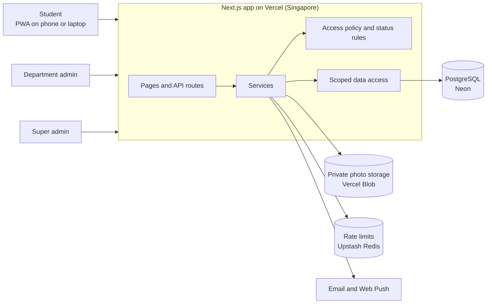

<div align="center">


# CampusConnect

**Every campus issue, heard and handled.**

A smart complaint and feedback platform for universities. Students report problems in under a minute, each complaint is routed to the right office automatically, staff resolve it with a full audit trail, and management sees what keeps going wrong. Installable on phones and desktops as a PWA.

[](https://campusconnect-delta-topaz.vercel.app)
[](docs/README.md)


[](LICENSE)
[](https://github.com/sudais-khalid/campusconnect/actions/workflows/ci.yml)

</div>

<p align="center">
  
</p>

## Highlights

| Feature | What it does |
|---|---|
| **Automatic routing** | Students pick a category; the server assigns the department (Cafeteria, Library, Labs & IT, Academic). Routing is data, editable by the Super Admin. |
| **Server-side access control** | Every query is scoped to the user's role inside the SQL. A Library admin opening a Lab/IT complaint by URL gets a 403, and the attempt is audited. |
| **Live updates** | Status changes, replies and new complaints appear on open screens within seconds, without reloading. |
| **Installable app** | Works on Android, iPhone and desktop. Read complaints and write new ones offline; they send when the connection returns. |
| **Anonymous reporting** | Students can hide their identity from the department. Only the Super Admin can reveal it, with a recorded reason. |
| **Accountability** | Required reasons for rejection and resolution, a timeline on every complaint, due dates by priority, overdue escalation, satisfaction ratings. |
| **Insight** | KPIs, weekly trends, complaints by department, recurring issues, response times and CSV export. |
| **Security** | Email verification, staff two-step verification, revocable sessions, rate limits, photo re-encoding that strips location data, private storage. |

## Screenshots

<table>
  <tr>
    <td width="50%"></td>
    <td width="50%"></td>
  </tr>
  <tr>
    <td></td>
    <td></td>
  </tr>
</table>

<p align="center">
  
  &nbsp;&nbsp;
  
</p>

## Try it

**Live:** <https://campusconnect-delta-topaz.vercel.app>

| Role | Email | Password |
|---|---|---|
| Student | `student1@biit.edu.pk` | `Campus#Connect2026` |
| Lab / IT admin | `labit.admin@biit.edu.pk` | `Campus#Connect2026` |
| Library admin | `library.admin@biit.edu.pk` | `Campus#Connect2026` |
| Super admin | `superadmin@biit.edu.pk` | `Campus#Connect2026` |

Demo accounts and data exist for evaluation only. A production launch replaces them with one-time staff passwords.

## How it works



| Layer | Technology | Why |
|---|---|---|
| App | Next.js 16 (App Router), React 19, TypeScript strict | One codebase for UI and API, server-rendered pages, access checks next to the data |
| Data | PostgreSQL on Neon, Prisma | Relational data, database-enforced rules, SQL analytics |
| Auth | Better Auth | Email verification, revocable database sessions, TOTP for staff |
| UI | Tailwind CSS v4, Lucide icons, hand-built SVG charts | Accessible, fast, consistent design tokens |
| PWA | Web App Manifest, custom service worker, IndexedDB outbox | Install, offline drafts, push notifications |
| Infra | Vercel, Vercel Blob, Upstash Redis, GitHub | Managed, low-cost, portable to self-hosting |

Every decision is explained in the [architecture decision records](docs/03-architecture-decisions.md).

## Run locally

```bash
npm install
cp .env.example .env
npm run dev:up        # Postgres, MinIO (S3) and Mailpit in Docker
npm run db:deploy     # create the tables
npm run db:seed       # departments, categories, staff and demo data
npm run icons         # PNG app icons
npm run dev           # http://localhost:3000
```

| Command | Purpose |
|---|---|
| `npm test` | Unit tests for the access policy, status rules, SLA and validation |
| `node scripts/smoke-test.mjs [url]` | End-to-end lifecycle and access-control checks against a running server |
| `npm run lint` / `npm run typecheck` | ESLint (with layer-boundary rules) and TypeScript |
| `npm run docs:build` | Regenerate the visual documentation site |

## Project structure

```text
src/
  app/            pages (student, admin, auth) and /api/v1 route handlers
  components/     UI kit, charts, complaint screens, layout, PWA
  domain/         pure rules: access policy, status machine, SLA
  modules/        services: complaints, attachments, notifications, analytics, org, audit
  lib/            config, auth, sessions, storage, email, push, rate limits, logging
prisma/           schema, migrations, seed
docs/             architecture, decisions, data model, security, API, PWA, deployment
public/           service worker and app icons
```

## Documentation

| Topic | Document |
|---|---|
| Requirements and scope | [Product & requirements](docs/01-product-and-requirements.md) |
| Architecture | [System architecture](docs/02-system-architecture.md), [Decisions](docs/03-architecture-decisions.md) |
| Data | [Data model](docs/04-data-model.md) |
| Security | [Security & access control](docs/05-security-and-access-control.md) |
| API | [API design](docs/06-api-design.md) |
| Mobile | [PWA & mobile](docs/07-pwa-and-mobile.md) |
| Operations | [Deployment & operations](docs/09-deployment-and-operations.md), [Backend guide](docs/12-backend-guide.md) |
| Design | [Frontend design system](docs/13-frontend-design.md) |

## Contributing and security

Contributions are welcome; see [CONTRIBUTING.md](CONTRIBUTING.md) and the [Code of Conduct](CODE_OF_CONDUCT.md). Please report vulnerabilities privately as described in [SECURITY.md](SECURITY.md).

## License

Released under the [MIT License](LICENSE).

## Team

Built by **Sudais Khalid** and **Farooq Khan** for the BIIT Software Engineering Society application development competition, and designed to run as a real university service.
